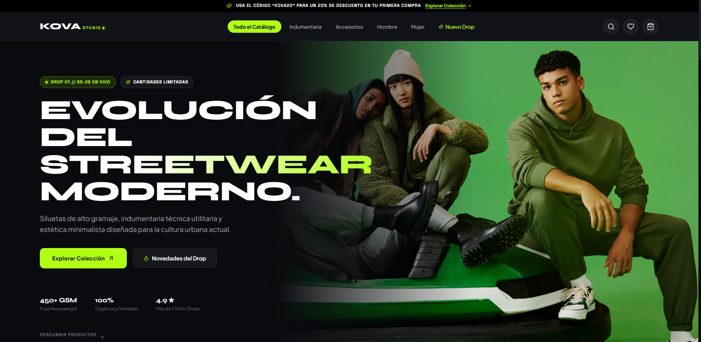
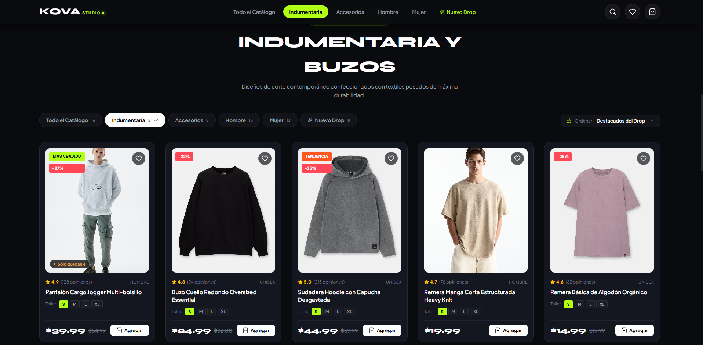
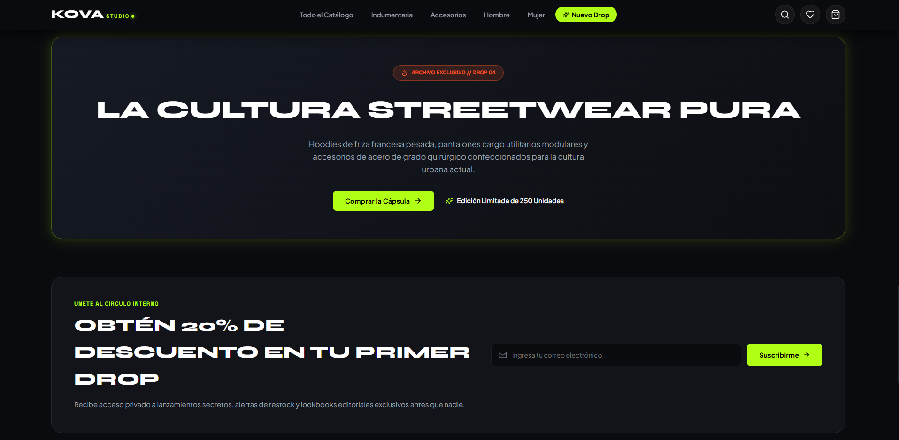
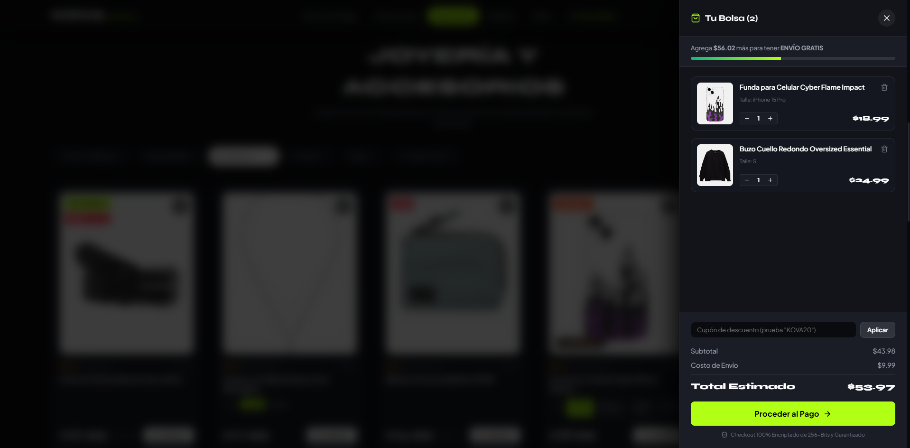

<div align="center">

# KOVA STUDIO •
### Streetwear & Alta Cultura Urbana 2026

*Plataforma e-commerce de indumentaria streetwear contemporánea con cortes arquitectónicos, estética dark glassmorphism y micro-interacciones de alta fidelidad.*

[](https://react.dev/)
[](https://www.typescriptlang.org/)
[](https://vitejs.dev/)
[](https://greensock.com/gsap/)

---

</div>

## 📸 Galería del Proyecto

|  |  |
|:---:|:---:|
| **Hero Section & Nuevos Drops** | **Catálogo con Filtros Personalizados** |

|  |  |
|:---:|:---:|
| **Quick View & Detalle de Prenda** | **Carrito Lateral & Checkout en Vivo** |

---

## ✨ Experiencia y Funcionalidades

- **⚡ Dirección de Arte & Estética Urbana:** Paleta cromática monocromática profunda con acentos en verde neón, tipografías display de alto impacto y acabados en *glassmorphism*.
- **🎬 Animaciones Cinematográficas GSAP:** Efectos de entrada secuenciales, parallax dinámico en scroll, contadores numéricos interactivos e integración con ScrollTrigger.
- **🔍 Catálogo Dinámico & Filtros Avanzados:** Sistema de filtrado por categoría (Indumentaria, Accesorios, Hombre, Mujer, Drops) y selector personalizado de ordenamiento por precio, valoración o novedad.
- **🛍️ Quick View Modal & Talles:** Modal interactivo para inspección rápida de productos, selección de talles, badges de stock limitado y cálculo de cuotas sin interés.
- **🖤 Carrito Lateral & Favoritos:** Drawer interactivo con cálculo automático de envíos gratis, gestión de cantidades, persistencia de lista de deseos y confirmación de compra.
- **📱 Responsive & Mobile First:** Experiencia fluida y consistente en smartphones, tablets y pantallas de escritorio.

---

## 🛠️ Stack Tecnológico

- **Frontend:** React 18 + TypeScript
- **Bundler & Tooling:** Vite
- **Animaciones:** GSAP + ScrollTrigger
- **Iconografía:** Lucide React
- **Estilos:** Vanilla CSS con variables de diseño, Glassmorphism y Flex/Grid layouts

---

## 🚀 Instalación y Puesta en Marcha

Sigue estos sencillos pasos para clonar y ejecutar el proyecto localmente en tu entorno de desarrollo.

### 📋 Requisitos Previos

- [Node.js](https://nodejs.org/) (versión 18 o superior recomendada)
- Gestor de paquetes: [pnpm](https://pnpm.io/) (recomendado), `npm` o `yarn`

### 💻 Pasos de Instalación

1. **Clonar el repositorio:**
   ```bash
   git clone https://github.com/tu-usuario/KovaStore.git
   cd KovaStore
   ```

2. **Instalar dependencias:**
   ```bash
   pnpm install
   # o si usas npm:
   # npm install
   ```

3. **Iniciar el servidor de desarrollo:**
   ```bash
   pnpm dev
   # o con npm:
   # npm run dev
   ```
   Abre [http://localhost:5173](http://localhost:5173) en tu navegador para ver la aplicación en vivo.

### 📦 Scripts Disponibles

| Comando | Descripción |
| :--- | :--- |
| `pnpm dev` | Inicia el entorno local con Hot Module Replacement (HMR). |
| `pnpm build` | Compila TypeScript y genera el bundle optimizado para producción en `dist/`. |
| `pnpm preview` | Previsualiza localmente el build de producción generado. |

---

<div align="center">
  
Diseñado para la cultura urbana actual. **Desarrollado por [WaveFrame Studio](https://waveframe.com.ar/)**

</div>
